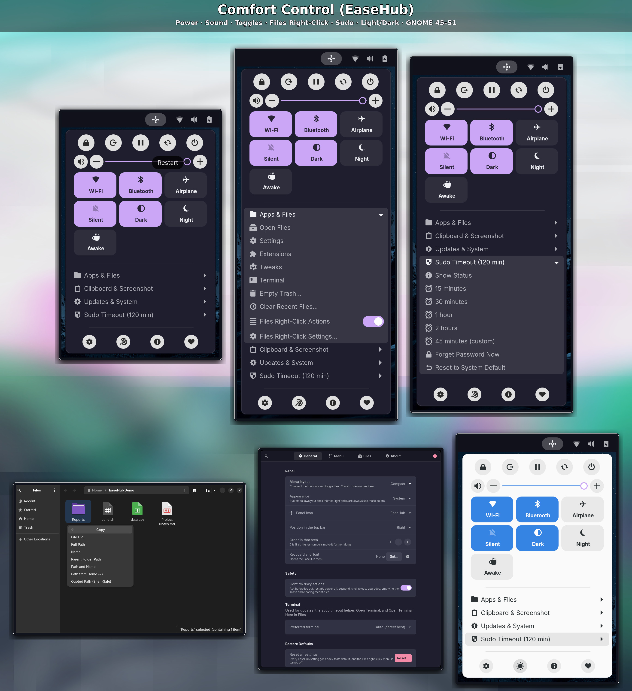
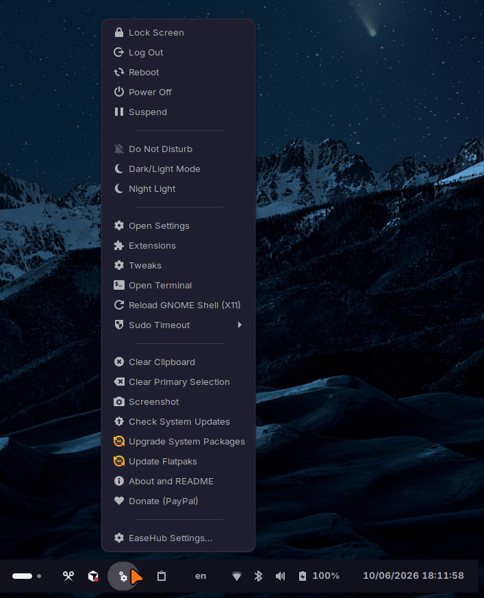
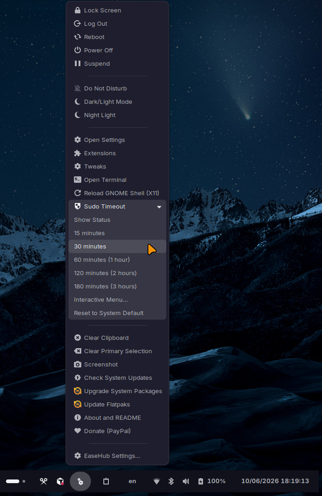
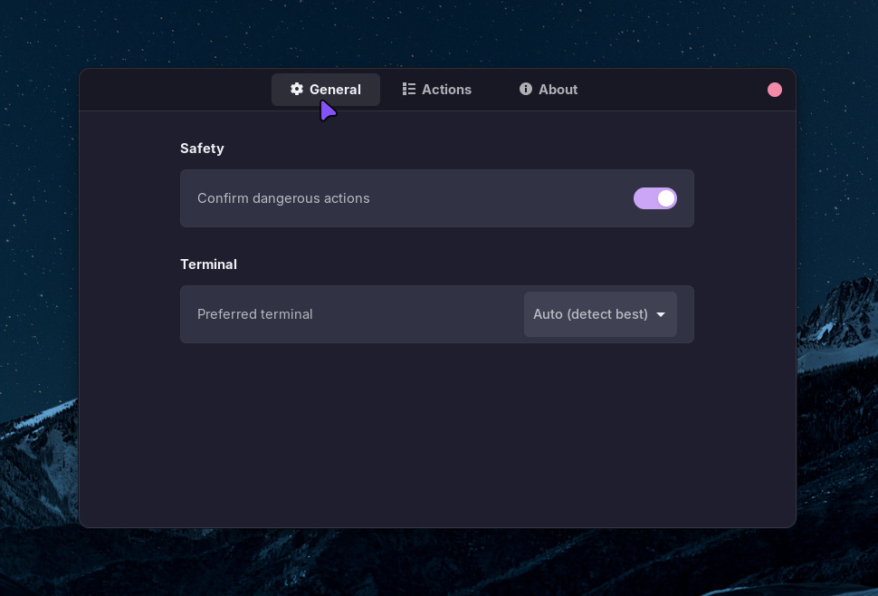
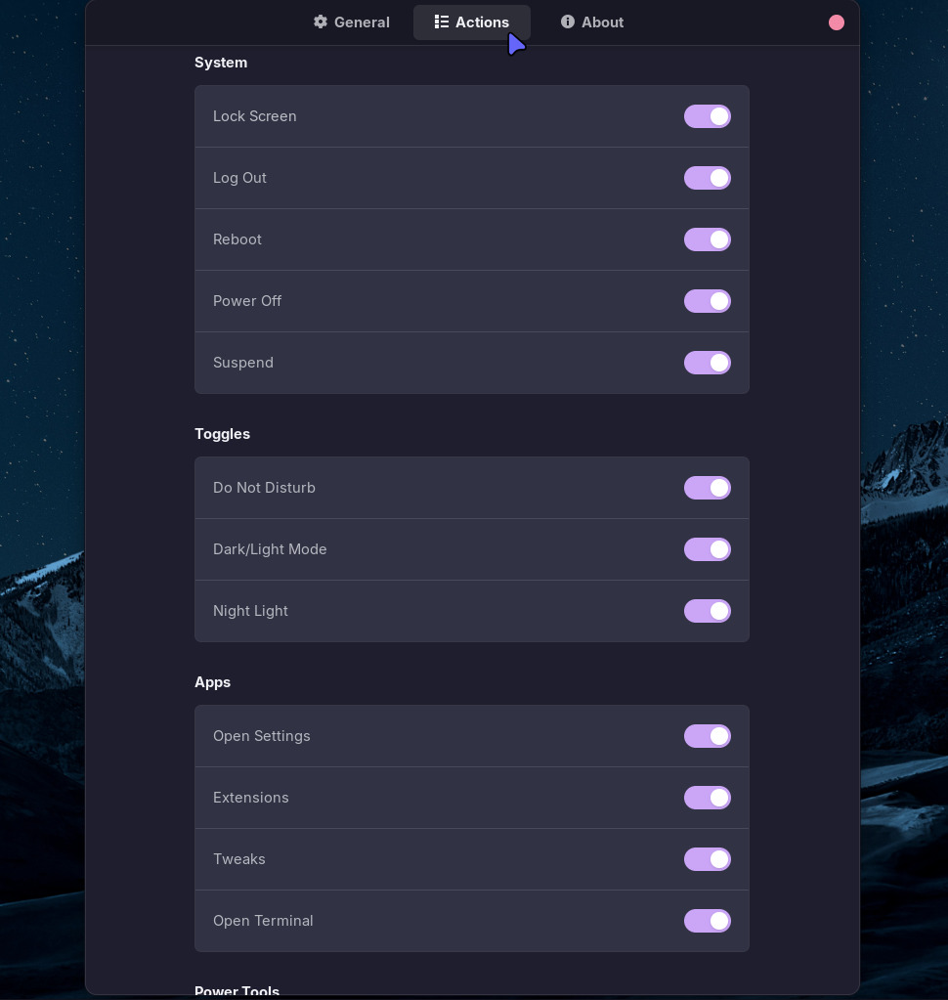
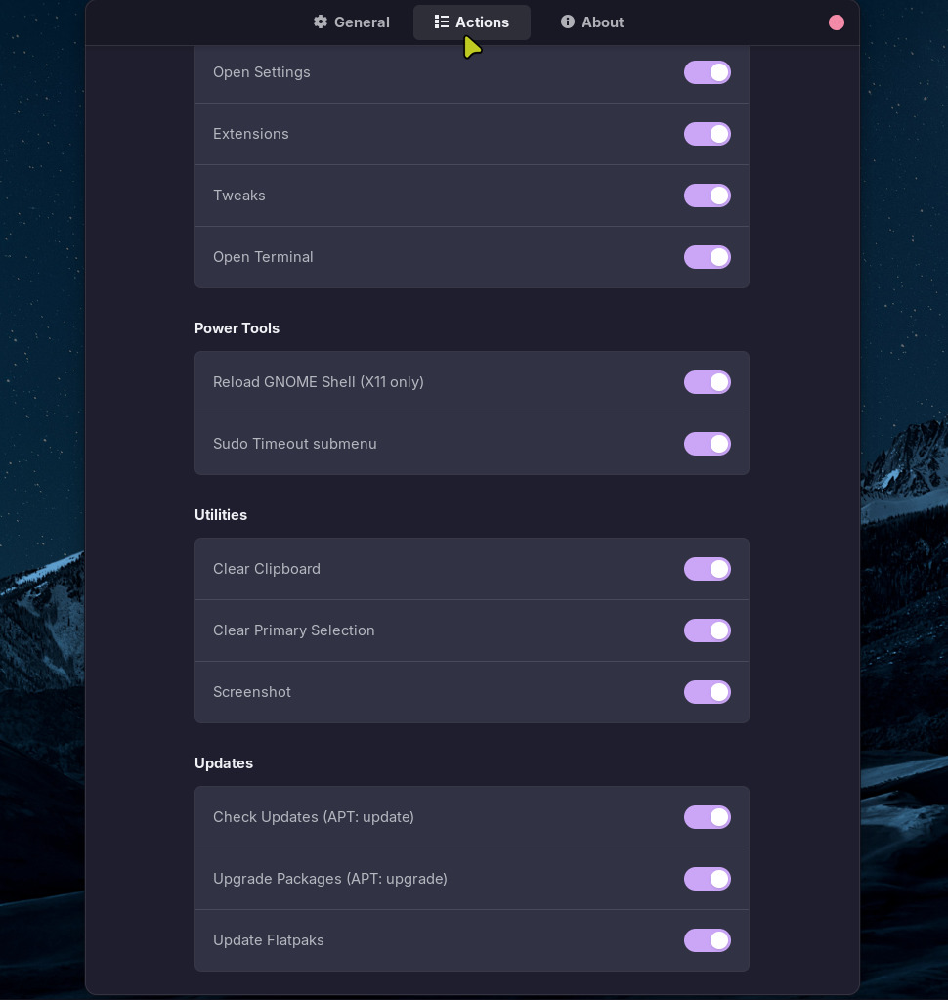
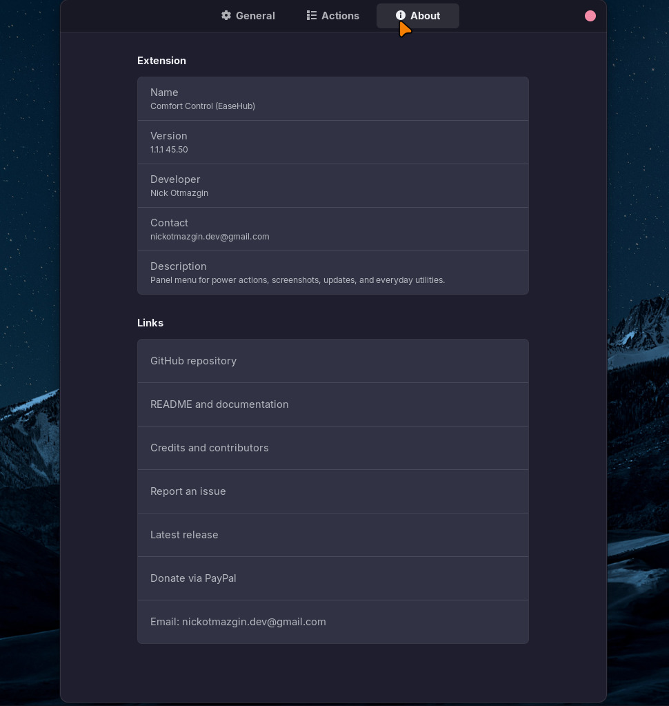

# Comfort Control (EaseHub)

[](https://github.com/nickotmazgin/comfort-control-easehub/releases/latest)
[](https://github.com/nickotmazgin/comfort-control-easehub/actions)
[](https://github.com/nickotmazgin/comfort-control-easehub/releases)
[](LICENSE)
[](#compatibility)
[](#compatibility)
[](#compatibility)
[](#compatibility)

[](https://github.com/nickotmazgin/comfort-control-easehub/issues)
[](https://github.com/nickotmazgin/comfort-control-easehub/discussions)

A **GNOME Shell extension** that brings **comfort and control to your desktop** — quick access to power actions, Wayland screenshots, system updates, and everyday utilities from one panel menu.

> **Keywords:** GNOME panel menu · power management · screenshots · Wayland · X11 · Xorg · dark mode · DND · terminal · Flatpak · APT · Linux utilities · open source

**Latest:** v1.3.0 — GNOME 45–51 ESM (**Wayland & X11/Xorg validated** on maintainer setups)

> Download [v1.3.0](https://github.com/nickotmazgin/comfort-control-easehub/releases/latest). Older releases remain for history and rollback.

> **GNOME Shell 42–44 is no longer supported.** EaseHub requires **GNOME 45–51**.

---

## Compatibility

| GNOME | Status | Notes |
| ----- | ------ | ----- |
| **45–51** | **Supported** | ESM build; zip `comfort-control@nickotmazgin-45-51` |
| **42–44** | **Discontinued** | No longer built or maintained |

| Session | Status | Notes |
| ------- | ------ | ----- |
| **Wayland** | **Supported · validated** | Power actions, screenshots, updates; shell reload hidden (log out/in) |
| **X11 / Xorg** | **Supported · validated** | Same as Wayland, plus **Reload GNOME Shell** via `xdotool` |

**Minimum requirement:** GNOME Shell **45** on a **Wayland or X11/Xorg** session.

---

## ✨ Features

A compact panel menu (about 10 rows) that keeps everyday controls one click away:

```
 🔒  ↪  ⏸  ⟳  ⏻                     power buttons
 🔊  −  ━━━━━━━━●━━━  +               volume
 [Wi-Fi] [Bluetooth] [Airplane]       quick toggles
 [Silent] [Dark] [Night] [Awake]
 📁 Apps & Files            ▸
 📋 Clipboard & Screenshot  ▸
 ⬆  Updates & System        ▸
 🛡  Sudo Timeout (60 min)   ▸
 ⚙   ⓘ   ♥                           settings · about · donate
```

### 🔋 Power
Lock, Log Out, Suspend, Restart and Power Off through GNOME Shell's own **SystemActions**
(the same path as the system menu). Everything except Lock asks first (configurable).

### 🔊 Sound
Mute, volume down, a slider and volume up for your current output device.

### 🎛️ Quick toggles
**Wi-Fi**, **Bluetooth**, **Airplane Mode**, **Do Not Disturb**, **Dark Mode**, **Night Light**
and **Keep Awake** (no screen blanking or sleep while on). Tiles show the current state every
time you open the menu, and hide themselves when the hardware or service isn't there.

### 📁 Apps & Files
Open Files (your home folder), Settings, Extensions, Tweaks, a terminal, **Empty Trash** (shows
how many items and asks first) and **Clear Recent Files** (asks first).

### 📸 Clipboard & Screenshot
Opens **GNOME's built-in screenshot tool** (area, screen, window, screencast), with a
`gnome-screenshot` fallback. Clear the clipboard or the primary selection.

### 🛠️ Updates & System
- **Check for Updates** and **Upgrade Packages** for APT, DNF, Zypper and Pacman (Arch uses
  `checkupdates`, never a partial `pacman -Sy`), plus **Update Flatpaks**
- Runs in your terminal, which stays open afterwards with the exit code; `pkexec` asks for your password
- **Reload GNOME Shell** on X11 through GNOME's own Alt+F2 → `r` path (via `xdotool`), verified
  from the Shell journal and a D-Bus ping. Hidden on Wayland.

### 🔐 Sudo Timeout
- Set how long `sudo` remembers your password: 15, 30, 60 or 120 minutes, your own **custom**
  value, or the system default. The menu shows the current value.
- **Forget Password Now** (`sudo -K`).
- Optional **one login for all terminals** (`timestamp_type=global`, off by default).
- Every change is **`visudo`-validated** before it is installed, written to one drop-in
  (`/etc/sudoers.d/99-easehub-sudo-timeout-<user>`), backed up, and **rolled back** if validation fails.

### 🖱️ Files right-click menu (optional)
Turn it on from **Apps & Files ▸ Files Right-Click Actions** in the menu (or **Preferences → Files**) to add **Scripts ▸ EaseHub** to the Files (Nautilus)
right-click menu:

| Copy ▸ | Open ▸ | Tools ▸ |
| ------ | ------ | ------- |
| Name · Full Path · Path and Name · Parent Folder Path · Path from Home (~) · Quoted Path (shell-safe) · File URI | Terminal Here · Open in Editor | Size and Type · SHA-256 Checksum · Make Executable |

Grouped or flat, rename the menu or any action, hide actions, notifications on or off, and
pick your editor. Works with several files at once, symbolic links, spaces, quotes and
non-Latin names. EaseHub only ever removes files it created.

### ⚙️ Preferences
- **General:** compact or classic layout, **appearance (System / Light / Dark)**, panel icon,
  position and order, a keyboard shortcut to open the menu, confirmations, preferred terminal
  (10 supported), and **Reset all settings**
- **Menu:** show or hide every item; sudo timeout options
- **Files:** the right-click menu
- **About:** version, links and more extensions

---

## 📦 Installation

### 📁 **From GitHub Release**

1. **Download** the latest release ZIP from the [**Releases Page**](https://github.com/nickotmazgin/comfort-control-easehub/releases/latest)

2. **Install** via GNOME Extensions app or terminal:
   ```bash
   gnome-extensions install --force comfort-control@nickotmazgin-45-51.shell-extension.zip
   gnome-extensions enable comfort-control@nickotmazgin
   ```

3. **Restart** GNOME Shell:
   - **Wayland**: Log out and back in
   - **Xorg**: Press **Alt+F2**, type `r`, and press Enter

### 🔧 **From Source (Developers)**

```bash
# Set extension UUID
uuid="comfort-control@nickotmazgin"

# Clone and install
git clone https://github.com/nickotmazgin/comfort-control-easehub.git \
  ~/.local/share/gnome-shell/extensions/"$uuid"

# Compile schemas
glib-compile-schemas ~/.local/share/gnome-shell/extensions/"$uuid"/schemas

# Enable extension
gnome-extensions enable "$uuid"
```

**Note**: On Wayland, you may need to log out/in for changes to take effect.

### 📥 Which Zip Should I Download?

Download **`comfort-control@nickotmazgin-45-51.shell-extension.zip`** from the [Releases page](https://github.com/nickotmazgin/comfort-control-easehub/releases/latest) (GNOME Shell **45–51** only). That is **v1.3.0** today.

| Release | Status |
| ------- | ------ |
| **v1.3.0** | **Recommended** — compact menu, sound, quick toggles, files and trash, Files right-click menu |
| v1.2.0 | Not released separately — its fixes (GNOME 51, terminals, screenshots) are part of v1.3.0 |
| **v1.1.4** | Superseded; kept for history / rollback (GNOME 45–50) |
| v1.1.3 | Superseded; kept for history / rollback |
| v1.1.2 and older | Archived; see [CHANGELOG](CHANGELOG.md) |

### 🧪 Packaging (CI)

On tag push (`v*`), GitHub Actions runs `create-release-zips.sh` and publishes:

- `comfort-control@nickotmazgin-45-51.shell-extension.zip` (the GNOME range in the name follows `shell-version` in `metadata.json`)

Build it locally with `./create-release-zips.sh`, or `./package.sh --install` to build and install it for your user.

---

## 🖼️ **Screenshots**

*Screenshots from EaseHub v1.1.4 (v1.2.0 shows Do Not Disturb, Dark Mode and Night Light as switches) — click any image to view it full size.*

[](screenshots/collage.jpg)

<table>
  <tr>
    <td align="center">
      <a href="screenshots/m1.jpg"></a><br>
      <b>m1</b> — Panel menu (all actions)
    </td>
    <td align="center">
      <a href="screenshots/m2.jpg"></a><br>
      <b>m2</b> — Sudo Timeout submenu
    </td>
    <td align="center">
      <a href="screenshots/m3.jpg"></a><br>
      <b>m3</b> — Preferences · General
    </td>
  </tr>
  <tr>
    <td align="center">
      <a href="screenshots/m4.jpg"></a><br>
      <b>m4</b> — Actions · System &amp; Toggles
    </td>
    <td align="center">
      <a href="screenshots/m5.jpg"></a><br>
      <b>m5</b> — Actions · Power Tools &amp; Updates
    </td>
    <td align="center">
      <a href="screenshots/m6.jpg"></a><br>
      <b>m6</b> — Preferences · About
    </td>
  </tr>
</table>

We welcome contributions! Please feel free to:
- 🐛 **Report bugs** via [GitHub Issues](https://github.com/nickotmazgin/comfort-control-easehub/issues)
- 💡 **Suggest features** or improvements
- 🔧 **Submit pull requests** with enhancements
- 🌐 **Help with translations**

See [CONTRIBUTING.md](CONTRIBUTING.md) for the development loop and [CHANGELOG.md](CHANGELOG.md) for notable changes.

---

## 📄 **License**

This project is licensed under the [**MIT License**](LICENSE) © **Nick Otmazgin**

---

## ☕ **Support the Project**

If **EaseHub** enhances your GNOME experience, consider supporting its continued development:

[](https://www.paypal.com/donate/?hosted_button_id=4HM44VH47LSMW)

Your support helps maintain and improve this extension for the entire GNOME community! 💙

---

## 👤 **About**

- Author: **Nick Otmazgin**
- Contact: **nickotmazgin.dev@gmail.com**

---

## Credits & Acknowledgements

Comfort Control (EaseHub) is created, maintained, signed, and released by **[Nick Otmazgin](https://github.com/nickotmazgin)** — the project's sole administrator and solo developer, who authors and reviews all code that ships.

[](https://openai.com/codex/)
[](https://cursor.com)
[](https://claude.com/claude-code)

Recent releases were built with help from AI pair-programming agents, operated under the maintainer's direction and review:

- **OpenAI Codex** — release engineering, signed-tag release workflows, packaging and validation hardening
- **Cursor (Agent)** — code review, debugging, CI workflow hardening, documentation
- **Claude** by Anthropic ([@claude](https://github.com/claude), via [Claude Code](https://claude.com/claude-code)) — v1.2.0 audit and v1.3.0 features: compact menu, sound and quick toggles, Files right-click menu, sudo timeout options, GNOME 51 port, nested-shell and unit tests, CI checks

Every AI-assisted change is human-reviewed, tested on real GNOME sessions, and approved by the maintainer before release. See [CONTRIBUTORS.md](CONTRIBUTORS.md) for the full credits.

> OpenAI and Codex are trademarks of OpenAI. Cursor is a trademark of Anysphere, Inc. Claude and Claude Code are trademarks of Anthropic, PBC. These names are used here solely for factual attribution. EaseHub is an independent project and is **not** affiliated with, sponsored, or endorsed by OpenAI, Anysphere/Cursor, or Anthropic.

---

## Find this project

**GitHub topics:** `gnome-shell-extension` · `panel-menu` · `power-management` · `screenshot` · `flatpak` · `wayland` · `x11` · `xorg` · `linux` · `productivity` · `open-source`

**Search for:** GNOME panel menu extension, Linux power menu, EaseHub GNOME, system utilities tray, screenshot extension GNOME

## More GNOME extensions by Nick Otmazgin

- [ClipFlow Pro](https://github.com/nickotmazgin/clipflow-pro) — clipboard history manager with pins, stars & privacy
- [Numeric Clock](https://github.com/nickotmazgin/Linux-Numeric-Date-And-Clock) — DD/MM/YYYY 24-hour top-bar clock with seconds

Also by Nick Otmazgin: [FluentVoice Pro](https://github.com/nickotmazgin/fluentvoice-pro) — system-wide text-to-speech app for Windows 11 and 10

---

*Made with ❤️ for the GNOME community*
